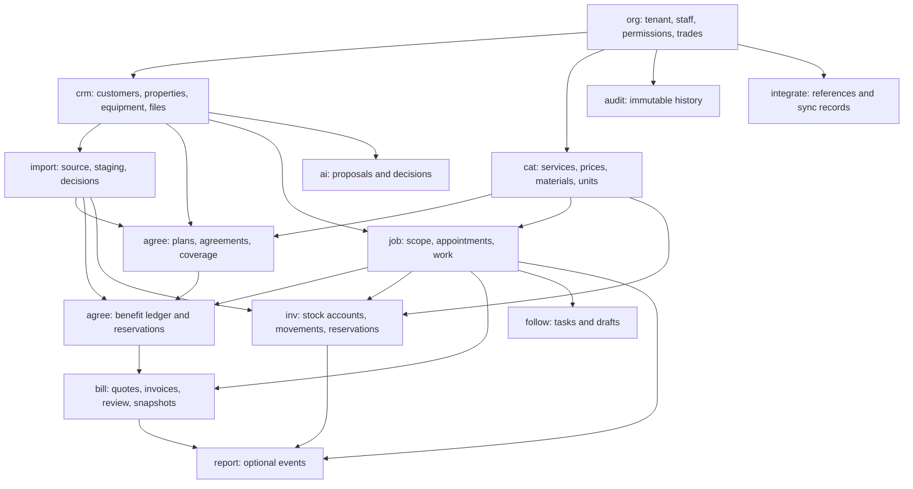

# Ownership and dependency design

The existing repository uses React/TypeScript/Vite with npm for the frontend, Python's standard HTTP server for operations, and psycopg2 for Tiger Cloud access. Its legacy schema has 11 loosely related tables, text tenant `demo`, text record IDs and JSON/text snapshots. It has no ORM or reusable standalone migration runner. The `X-Demo-Role` header is simulated identity, not authentication. This task neither changes those conventions in the application nor pretends their IDs already map to the new foundation.

The new isolated namespace uses UUID organization/record IDs and composite foreign keys. `org_members.auth_provider` plus opaque `auth_subject` references a future/existing identity provider; it stores no password, session, login, or competing auth account. Multiple organizations may reference the same external identity. Employee membership and roles are distinct from `agree_agreements` customer service membership.

## Module map

Arrows indicate parent-to-dependent references, not application data flows. Module ownership is encoded in every table prefix and SQL comment. `agree` has a contract layer before jobs and a fulfillment layer after jobs; jobs never reference benefit ledgers, avoiding a circular dependency. Billing points to confirmed work/benefit consumption, never the reverse. Import references metadata/staff and stores proposed target identifiers as non-authoritative evidence; authoritative ledgers can then point back to source records without a cycle.

The complete physical FK graph is in ERD.md. The schema generator topologically sorts it and fails if a circular dependency appears. Self-references only represent inventory/benefit reversals, equipment replacement, or renewal history and do not introduce cross-module cycles. Relationship tables represent many-to-many jobs/trades, jobs/equipment, appointment/technician assignments, customers/properties, staff/roles, and role/permissions.

No universal entity/workflow engine exists. A few intentionally non-authoritative pointers (`audit_events.record_*`, AI proposed targets, import candidates/outcomes and external mappings) use a table discriminator and UUID because they must retain evidence when records do not yet exist or have been archived. They are never used as validated authorization or execution targets. Normal operational relationships have concrete composite FKs.

## Cardinality, indexes, lifecycle

Every business table has a documented PK. All except the organization root are directly tenant-owned; foreign keys include the tenant. Child-to-parent FKs are many-to-one, nullable only where documented; composite unique constraints encode one-to-one or unique relationship pairs. Every reference has a tenant-leading index. Additional indexes cover event time/type, audit affected-record/time, scheduled appointments, open follow-ups and active reservations.

The schema does not cascade deletion. Retire/disable/archive live reference records where supported, and preserve referenced rows. Immutable histories use new versions, compensating adjustments or reversals. Operational status histories and audit events are records to be written by future application integration, not magically generated by the current application.

No retention policy removes authoritative history. Database-wide migration metadata is owned by tooling rather than a business tenant; fixture manifests are keyed by the known organization/table/record and are inaccessible to PUBLIC through their schema.
